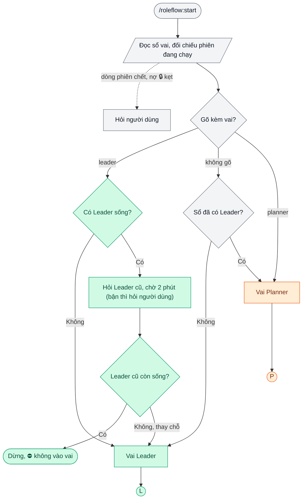
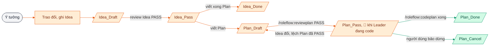
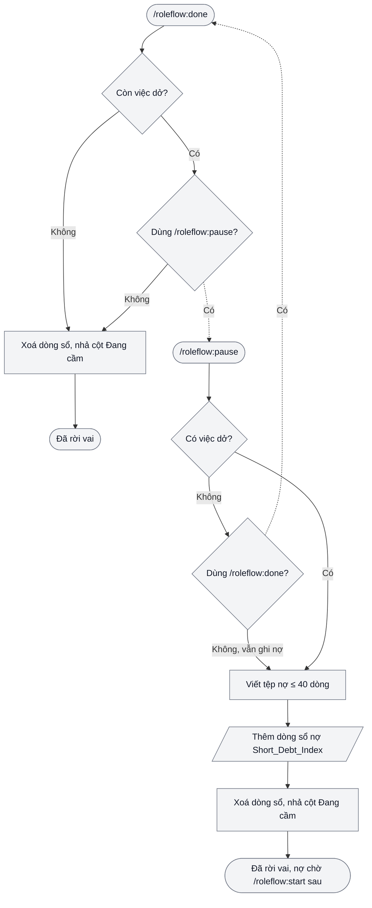

# roleflow

Plugin Claude Code chạy **flow hai vai** (Leader, Planner) trên dự án của bạn: ý tưởng thành Plan, Plan được rà,
rồi thi công bằng subagent (Coder, Reviewer, Tester), có sổ vai, mục lục việc và sổ nợ để nhiều phiên chạy song song không giẫm chân nhau.

**Dành cho ai.** Người dùng Claude Code làm dự án có code, chạy nhiều phiên cùng lúc hoặc nối một việc qua nhiều ngày.

## Vấn đề nó giải

- Nhiều phiên cùng sửa một chỗ, giẫm chân nhau, ⛔ không ai biết việc nào đã có người nhận.
- Phiên hết ngữ cảnh giữa chừng, việc dở mất theo; phiên sau phải hỏi lại từ đầu.
- Code trước khi nghĩ xong: sửa đi sửa lại vì thiết kế đổi giữa lúc thi công.
- Báo "xong" mà chưa đo; lỗi lộ ra khi người dùng tự thử.

## Lợi ích, và cơ chế mang lại

- **Phiên ⛔ không giẫm chân:** sổ vai có khoá giữ đúng một Leader; cột Đang cầm ở mục lục cho biết dòng nào đã có người nhận.
- **Việc dở ⛔ không mất:** `/roleflow:pause` ghi tệp nợ ngắn và một dòng sổ nợ; `/roleflow:start` lần sau đọc sổ nợ trước tiên.
- **Nghĩ xong mới code:** Planner ⛔ không code; Plan phải qua `/roleflow:reviewplan` PASS mới sang `Plan_Pass`, Leader chỉ nhận Plan từ đó.
- **"Xong" là đã đo:** `/roleflow:codeplan` giao Coder viết, Reviewer đọc, Tester đo theo tiêu chí ghi sẵn trong Plan; cửa verify đúng kho chạy trước khi báo.

## Flow là gì

- **Hai vai:** Planner viết Idea, Plan; Leader cầm Plan đã chắc, giao subagent thi công, đo, đóng Plan.
  Luật đầy đủ ở `rulebook/Roles.md` (gọi skill `roleflow:role-show` để đọc lại).
- **Lệnh chính:** `/roleflow:start` (vào vai), `/roleflow:done` (rời vai), `/roleflow:pause` (dừng giữa chừng, ghi việc dở),
  `/roleflow:codeplan` (thi công một Plan bằng Coder, Reviewer, Tester), `/roleflow:reviewplan` (rà nội dung Plan), `/roleflow:checkplan` (rà trạng thái Plan),
  `/roleflow:PlanModule` (lập kế hoạch module lớn), `/roleflow:exportplan` (xuất Plan ra HTML), `/roleflow:newprojectapp` (khởi tạo dự án mới), `/roleflow:git` (quy trình deploy an toàn).
- **Agent đi kèm:** executor, reviewer, qa-testing, plan-reviewer, plan-checker, researcher, security-auditor,
  database-architect, supabase-expert, ui-designer.
- **Skill tra luật:** `roleflow:rules-details` (bản đầy đủ luật chung), `roleflow:english-naming` (đặt tên tiếng Anh),
  `roleflow:ctx` (đo ngữ cảnh phiên), `roleflow:role-show` (nạp lại luật vai, xem sổ vai).
- **Sổ, mục lục:** `scripts/activerole.py` giữ sổ vai, mục lục Plan, sổ nợ của từng dự án; mọi lệnh vai đều gọi script này.

## Yêu cầu

- **macOS**: vài skill mở tệp ảnh, HTML bằng lệnh `open` của macOS.
- **python3**: mọi lệnh vai gọi `scripts/activerole.py`.
- **MCP** cho agent cần tới: `chrome-devtools` (đo giao diện, chụp màn), `supabase` (đọc, soát cơ sở dữ liệu).

## Cài

```
claude plugin marketplace add quangcine/roleflow
claude plugin install roleflow@roleflow
```

Hoặc gõ trong phiên Claude Code:

```
/plugin marketplace add quangcine/roleflow
/plugin install roleflow@roleflow
```

Mở phiên Claude Code mới để plugin có hiệu lực.

Lệnh, agent của plugin mang tiền tố `roleflow:`. Gõ tên trần (vd <code>/start</code>) cũng chạy khi máy không có skill nào khác trùng tên; tài liệu dùng tên có tiền tố cho chắc.

## Cập nhật

```
claude plugin marketplace update roleflow
claude plugin update roleflow@roleflow
```

Mở phiên Claude Code mới để bản mới có hiệu lực. Bản mới chỉ về khi số `version` đổi; `CHANGELOG.md` ghi từng bản.

## Chép mẫu CLAUDE.md

Luật chung của flow nằm ở `templates/CLAUDE.md`. Chép vào `~/.claude/CLAUDE.md` (đã có tệp này thì sao lưu trước, rồi gộp tay phần của bạn):

```
cp ~/.claude/CLAUDE.md ~/.claude/CLAUDE.md.bak 2>/dev/null
curl -fsSL https://raw.githubusercontent.com/quangcine/roleflow/main/templates/CLAUDE.md -o ~/.claude/CLAUDE.md
```

Mẫu đổi theo bản mới thì `CHANGELOG.md` ghi "chép lại mẫu CLAUDE.md": chép lại như trên.

## Khai dự án vào flow-projects.json

`activerole.py` nhận dự án theo thư mục làm việc, đọc từ `~/.claude/flow-projects.json`.
Mỗi dự án một dòng, tên dự án trỏ tới thư mục gốc:

```json
{
  "MyApp": "~/MyAppDev",
  "Blog": "~/BlogDev"
}
```

Chưa có tệp thì tạo mới. Dự án mới tạo bằng `/roleflow:newprojectapp` thì skill tự thêm dòng này.
Mở Claude Code từ thư mục gốc dự án, gõ `/roleflow:start` để vào vai.

Cửa verify, tài khoản deploy của từng dự án ghi ở `CLAUDE.md` (hoặc `AGENTS.md`) gốc dự án đó.
Thư mục việc thì cố định, ⛔ không khai được: `activerole.py` ghi vào `01_IDEA/`, `05_PLANS/`, `11_DEBT/` và sổ vai `Active-Role.md` ở gốc dự án.
Dự án mới thì `/roleflow:newprojectapp` dựng đủ cây thư mục này.

## Một ngày làm việc

1. Mở Claude Code ở thư mục gốc dự án, gõ `/roleflow:start`: sổ trống nên phiên này thành Leader. Mở tab thứ hai, gõ `/roleflow:start planner`: thành Planner.
2. Ở tab Planner, kể ý tưởng; Planner trao đổi, ghi Idea, viết Plan, rồi gõ `/roleflow:reviewplan` tới khi PASS, Plan sang `Plan_Pass`.
3. Ở tab Leader, chọn Plan, gõ `/roleflow:codeplan`: subagent viết, rà, đo; xong thì Plan sang `Plan_Done`.
4. Hết ngữ cảnh giữa chừng thì gõ `/roleflow:pause`; hôm sau `/roleflow:start` hỏi bạn có trả nợ hay không. Hết việc thì gõ `/roleflow:done` ở từng tab để rời vai.

## Bốn sơ đồ

Viên thuốc là bắt đầu, kết thúc; chữ nhật là việc làm; thoi là rẽ nhánh; bình hành là đọc, ghi tệp mục lục; tròn là chỗ nối sang sơ đồ khác.

**1. `/roleflow:start` chọn vai.** Xanh lục là nhánh dẫn tới vai Leader, cam là Planner, xám là bước chung, nét đứt là nhánh phụ khi sổ có dòng phiên chết hay nợ kẹt; Leader cũ còn trả lời thì phiên mới dừng, nên sổ luôn chỉ có một Leader.



**2. Vào vai rồi đọc gì.** Làn xanh lục là Leader, làn cam là Planner, nét đứt là chỗ Leader làm luôn việc Planner khi sổ vắng Planner; bước nào có việc thì dừng ở đó hỏi người dùng, và Planner chỉ nhận dòng có cột Đang cầm trống rồi ghi mã mình vào.

```mermaid
flowchart TD
  subgraph LANE_L["Leader"]
    L0(("L")) --> LD{"Có nợ Leader?"}
    LD -->|"Có"| LT{"Trả nợ?"}
    LT -->|"Chọn nợ"| LN["Nhận nợ 🔒 rồi ✅, làm tiếp việc dở"]
    LT -->|"Việc mới"| LR[/"Đọc Plan_Pass"/] --> LQ{"Có Plan?"}
    LD -->|"Không"| LR
    LQ -->|"Có"| LC["Người dùng chọn Plan"] --> LCP["/roleflow:codeplan, dòng mang 🔨"] --> LDN[/"Chuyển dòng sang Plan_Done"/] --> LE(["Plan khác hoặc /roleflow:done"])
    LQ -->|"Không"| LHP{"Có Planner?"}
    LHP -->|"Có"| LW(["Chờ Plan mới"])
    LHP -.->|"Không: làm luôn việc Planner"| LX(("P"))
  end
  subgraph LANE_P["Planner"]
    P0(("P")) --> PD{"Có nợ Planner?"}
    PD -->|"Có"| PT{"Trả nợ?"}
    PT -->|"Chọn nợ"| PN["Nhận nợ 🔒 rồi ✅, làm tiếp việc dở"]
    PT -->|"Việc mới"| PR1[/"Đọc Plan_Draft"/] --> PQ1{"Có việc?"}
    PD -->|"Không"| PR1
    PQ1 -->|"Có"| PA1["Giữ chỗ, rà Plan, PASS sang Plan_Pass"]
    PQ1 -->|"Không"| PR2[/"Đọc Idea_Pass"/] --> PQ2{"Có việc?"}
    PQ2 -->|"Có"| PA2["Giữ chỗ, viết Plan vào Plan_Draft"]
    PQ2 -->|"Không"| PR3[/"Đọc Idea_Draft"/] --> PQ3{"Có việc?"}
    PQ3 -->|"Có"| PA3["Giữ chỗ, review Idea, PASS sang Idea_Pass"]
    PQ3 -->|"Không"| PH["Hỏi người dùng có ý tưởng mới"] --> PI["Trao đổi, ghi Idea vào Idea_Draft"]
  end
  classDef leader fill:#d1fae5,stroke:#059669,color:#064e3b
  classDef planner fill:#ffedd5,stroke:#ea580c,color:#7c2d12
  class L0,LD,LT,LN,LR,LQ,LC,LCP,LDN,LE,LHP,LW leader
  class LX,P0,PD,PT,PN,PR1,PQ1,PA1,PR2,PQ2,PA2,PR3,PQ3,PA3,PH,PI planner
  style LANE_L fill:#ecfdf5,stroke:#059669
  style LANE_P fill:#fff7ed,stroke:#ea580c
```



**3. Vòng đời một việc.** Cam là bước Planner chuyển, xanh lục là bước Leader chuyển, xám là điểm khởi, nét đứt là đường lùi khi Idea đổi làm lệch Plan đã PASS; mỗi mũi tên chỉ là chuyển một dòng sang tệp mục lục khác, tệp Idea, Plan đứng yên nên ⛔ không phải nắn link.



**4. Rời vai: `/roleflow:done` và `/roleflow:pause`.** Hai lệnh dùng chung cho cả hai vai nên tô xám, nét đứt là chỗ hai lệnh hỏi chéo nhau; Leader đang có subagent chạy thì chờ xong rồi mới ghi nợ.



## Tự dựng flow riêng

Muốn dựng flow vừa với cấu hình mình thay vì cài nguyên plugin: đưa Claude đọc https://github.com/quangcine/flow-code-for-ai.

## Giấy phép

MIT, xem `LICENSE`.
